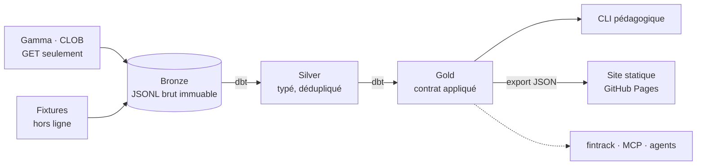

# polymarket-signals

> Lire les marchés prédictifs Polymarket pour **comprendre** le contexte macro, jamais pour parier.
> Pipeline data propre (bronze → silver → gold), testé, documenté, et une Académie pour
> apprendre en chemin.

Projet compagnon de [fintrack](../fintrack/README.md) : fintrack gère l'épargne (stratégie
passive), polysignals explique ce que le monde anticipe (Fed, BCE, inflation, récession) sans
jamais pousser à agir.

## En 30 secondes

```bash
make install
make web-demo        # pipeline complet hors ligne (données synthétiques) + site sur http://localhost:3100
make explain M=ecb-cut-december-2026 DATA_DIR=data-demo   # la même explication, dans le terminal
make help            # toutes les commandes
```

```
╭─ 1. Ce que dit le marché ───────────────────────────────────────────╮
│ Les participants estiment à 41 % la probabilité que la réponse soit │
│ « Oui ». … écart 22.0 pts (écart trop large → dernier prix échangé) │
╰─────────────────────────────────────────────────────────────────────╯
╭─ 3. Peut-on s'y fier ? ─────────────────────────────────────────────╮
│ Signal INEXPLOITABLE : le prix affiché ne mesure pas grand-chose.   │
│   · écart achat/vente très large (22.0 pts)                         │
╰─────────────────────────────────────────────────────────────────────╯
```

## Architecture



| Couche | Techno | Garantie |
|---|---|---|
| Ingestion | Python 3.12, httpx, pydantic | lecture seule, liste blanche, TLS, retries, contrats |
| Bronze | JSONL gzip partitionné (Hive) | immuable, idempotent (empreinte sha256) |
| Silver / Gold | dbt-duckdb | 60 tests, test unitaire, contrat de schéma |
| Site | Next.js 16 (export statique), SVG fait main | zéro appel réseau, CSP stricte |
| Production | GitHub Actions (cron) + Pages (OIDC) | 0 €, aucun secret, publié seulement si tout est vert |
| Qualité | ruff, mypy strict, pytest, pip-audit, eslint, tsc, npm audit | `make check` = CI |

Détails : [architecture](docs/architecture.md) · [contrats de données](docs/data-contracts.md) ·
[sécurité](docs/security.md) · [runbook](docs/runbook.md) · [feuille de route](docs/roadmap.md)

## Apprendre

L'[Académie](academy/README.md) : 7 leçons courtes, chacune reliée au code.

00 architecture data · 01 prix = probabilité · 02 carnet d'ordres et liquidité ·
03 résolution et oracle · 04 biais et limites · 05 lire un signal macro sans spéculer ·
06 cadre légal en France

## Statut

v0.2 : site web et pipeline quotidien. L'ingestion réelle tourne sur GitHub Actions, car
depuis la France les fournisseurs d'accès bloquent Polymarket au niveau DNS (ANJ, `make doctor`).
En local, tout fonctionne hors ligne sur des données synthétiques. Voir le
[runbook](docs/runbook.md).

## Principes non négociables

- **Lecture seule** : aucune clé, aucun wallet, aucun ordre.
- **Le brut est sacré** : bronze immuable, tout le reste se reconstruit (`make rebuild`).
- **Informer, pas conseiller** : aucune sortie ne recommande d'agir sur son épargne.
