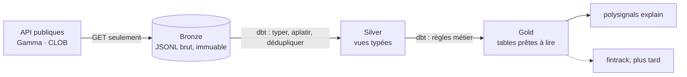

# 00 · L'architecture data, expliquée

## Le problème

Une API renvoie un état **à un instant**. Si on calcule directement des indicateurs dessus, on
perd l'historique, on ne peut pas rejouer un calcul après une correction, et un changement de
format côté API produit des chiffres faux sans bruit.

## La réponse : trois couches (« médaillon »)

| Couche | Contenu | Règle d'or |
|---|---|---|
| **Bronze** | la réponse brute, dans une enveloppe (date, run, empreinte, contrat) | on n'interprète rien, on ne modifie jamais |
| **Silver** | colonnes typées, listes aplaties, doublons retirés | une ligne = un grain clairement nommé |
| **Gold** | indicateurs métier : probabilité, variations, qualité du signal | c'est l'interface publique, son schéma est garanti |

## Trois idées clés

**1. Idempotence.** Chaque enregistrement a une empreinte
`sha256(source | endpoint | clé | contenu)`. Relancer l'ingestion sans changement côté source
n'écrit rien. On peut donc relancer sans crainte après une panne.

**2. Contrats de données.** Chaque enregistrement est validé (pydantic) à l'arrivée, et le
résultat voyage avec lui. Un test dbt échoue si un contrat est violé : un changement d'API se
voit **le jour même**.

**3. L'entrepôt est jetable.** Les fichiers bronze sont la seule source de vérité. `make rebuild`
supprime la base DuckDB et la reconstruit en quelques secondes. Corriger une règle = relancer,
jamais « réparer des données à la main ».

## Pourquoi ces outils

- **DuckDB** : une base analytique dans un fichier, sans serveur, qui lit JSON et Parquet
  directement. Idéal pour un projet personnel, et cela fonctionne sans changement jusqu'à
  des dizaines de millions de lignes.
- **dbt** : le SQL versionné, testé et documenté. `make docs` affiche le lignage complet.
- **uv** : environnement Python reproductible (`uv.lock`).

## Dans le code

- `src/polysignals/bronze.py` : enveloppe, empreinte, écriture atomique
- `src/polysignals/models.py` : contrats
- `transform/models/` : `staging/` (silver), `intermediate/`, `marts/` (gold)
- `transform/models/marts/_marts.yml` : `contract: enforced` sur `mart_macro_watchlist`

## À retenir

> On garde le brut, on transforme en SQL testé, on expose un schéma garanti.
> Tout le reste se reconstruit.
