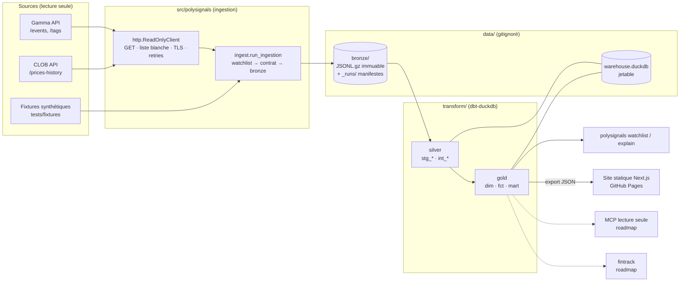

# Architecture

## Vue d'ensemble



## Flux d'une exécution (`make pipeline`)

1. `polysignals ingest --source live` lit `transform/seeds/watchlist_selectors.csv`
   (**source unique** de la watchlist, partagée avec dbt).
2. Pour chaque sélecteur : `GET /events?tag_slug=…&closed=false` (paginé, borné par
   `max_pages`).
3. Pour chaque marché binaire actif : `GET /prices-history?market=<token Yes>` (borné par
   `max_history_tokens`, les plus liquides d'abord).
4. Chaque enregistrement est validé contre son contrat puis écrit en bronze s'il est nouveau.
5. Un manifeste `_runs/<run_id>.json` est écrit, **même en cas d'échec** (statut `failed`).
6. `dbt build` : seeds → silver → gold, avec tous les tests (génériques, singuliers, unitaires,
   contrat).

## Modèles dbt et grains

| Modèle | Couche | Grain | Matérialisation |
|---|---|---|---|
| `stg_gamma__events` | silver | événement × instantané | vue |
| `stg_gamma__event_tags` | silver | événement × tag (dernier état) | vue |
| `stg_gamma__market_snapshots` | silver | marché × instantané | vue |
| `stg_clob__price_history` | silver | token × horodatage | vue |
| `stg_ingestion_runs` | silver | run | vue |
| `int_event_themes` | silver | événement × thème | vue |
| `int_market_snapshots_priced` | silver | marché × instantané | vue |
| `dim_markets` | gold | marché | table |
| `fct_market_snapshots` | gold | marché × instantané | table |
| `fct_daily_prices` | gold | marché × jour | table |
| `mart_macro_watchlist` | gold | marché × thème (**contrat appliqué**) | table |

Les vues silver référencent les fichiers bronze par chemin absolu : le Makefile passe toujours
`POLYSIGNALS_DATA_DIR` en absolu. Les consommateurs (CLI, fintrack, MCP) ne lisent **que gold**.

## Publication (site web)

```
GitHub Actions (cron)          branche data            GitHub Pages
 ingest ───────────────────▶ bronze/ (git)
 dbt build ◀─────────────────┘
 export → web/data/gold.json → next build (output: export) → web/out ──OIDC──▶ site
```

- `web/data/gold.json` est le **seul** contrat entre pipeline et site (`schema_version: 1`,
  types dans `web/src/lib/data.ts`).
- Le site lit ce fichier **au build** : zéro appel réseau à l'exécution, pas d'API à protéger.
- Les leçons sont lues directement depuis `academy/*.md` : une seule source pour GitHub,
  Obsidian et le site.

## Choix structurants

Détail et alternatives écartées : `.claude/decisions.md`.

- **Bronze en fichiers, pas en base** : immuable, rejouable, lisible par n'importe quel outil.
- **Tables complètes, pas d'incrémental** : la reconstruction prend quelques secondes. On
  passera `fct_*` en incrémental quand une reconstruction dépassera la minute.
- **Variations ancrées sur l'historique** (et non `current_date`) : un `dbt build` donne le même
  résultat quel que soit le jour où il tourne.
- **Deux implémentations de source derrière un protocole** (`sources.py`) : la CI exécute le
  pipeline complet sans réseau.
- **Deux espaces de données** : `data/` (réel) et `data-demo/` (fixtures). Ils ne se mélangent
  jamais.
- **Bronze versionné dans git (branche `data`)** plutôt qu'un stockage objet : zéro compte, zéro
  secret, historique gratuit. Limite connue : quelques centaines de Mo, puis compaction.
